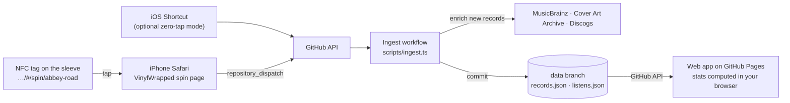

# VinylWrapped

**Spotify Wrapped for the records you actually spin.** Stick a cheap NFC tag on each record. Tap it with your iPhone when the needle drops, and VinylWrapped logs the spin. Over time you get stats on your top records, artists, genres, labels and decades, a listening clock, streaks, records gathering dust, your "listening personality", and a story-style **Wrapped** for every year.

It runs entirely on GitHub: **Pages** hosts the app, **Actions** is the backend, and a **git branch** is the database. There are no servers to maintain and no monthly bill.

| Stats | Tap a tag | Wrapped |
| --- | --- | --- |
|  |  |  |

## How it works



1. **The tag** stores a URL such as `https://you.github.io/VinylWrapped/#/spin/abbey-road`. iPhones (XS and newer) read NFC tags in the background, so you tap the phone on the sticker and then tap the "Open in Safari" banner.
2. **The spin page** shows a turntable dropping the needle, plus some fun facts ("32nd spin · last played 3 months ago · flip to side B around 9:47pm"). It sends a `spin` event to GitHub's `repository_dispatch` API.
3. **The Ingest workflow** (`.github/workflows/ingest.yml`) is the "server". It appends the spin to `listens.json` on the `data` branch. When you add a record, it looks it up on MusicBrainz and fills in title, artists (with origin country), original year, label, catalog number, pressing, tracklist with side lengths, genres, tags and cover art. Discogs styles and have/want counts are added when available.
4. **The web app** (`web/`, deployed by `.github/workflows/deploy.yml`) loads the two JSON files through the GitHub API and computes every stat in your browser (`shared/stats.ts`).

Stats include the following, each with a table view and a comparison to the previous period:

- totals and listening time
- top records, artists, genres, genre families, labels, countries and decades
- a listening clock, weekday chart and week × hour heatmap
- trend over time and a calendar heatmap
- streaks, the biggest day, binges, the longest session, comebacks and first spins
- records gathering dust
- your musical birth year
- a listening personality such as *"The Midnight Crate Digger"*

Ranges: 7/30/90 days, this year, last year, all time, or custom.

## Get your own VinylWrapped (about 15 minutes)

Everyone runs their own copy. Your records and spins live in your copy of the repository, and only you can add to them. You need a GitHub account and, for the NFC part, an iPhone XS or newer.

1. **Copy this repository:** click **Fork** at the top of this page (or **Use this template**, if you see it). You can keep the name `VinylWrapped` or pick another.
2. **Turn on Actions (forks only):** in your copy, open the **Actions** tab and click **I understand my workflows, go ahead and enable them**.
3. **Turn on Pages:** *Settings → Pages → Build and deployment → Source: **GitHub Actions***.
4. **Set your timezone:** *Settings → Secrets and variables → Actions → Variables → New repository variable*. Name it `VW_TIMEZONE` and give it your [IANA timezone](https://en.wikipedia.org/wiki/List_of_tz_database_time_zones), such as `Europe/London` or `America/New_York`. It's used for spins sent without a time; otherwise UTC is assumed.
5. **Deploy:** *Actions → Deploy → Run workflow*. After about two minutes your app is live at `https://<your-username>.github.io/VinylWrapped/` (with your repository's name if you renamed it). From then on it redeploys whenever `main` changes.
6. **Create a login token:** a [fine-grained personal access token](https://github.com/settings/personal-access-tokens/new) with *Repository access → Only select repositories → your copy* and *Repository permissions → **Contents: Read and write***. Nothing else is needed, and the app's login screen links to a pre-filled form.
7. **Log in** on your computer and on your iPhone (in Safari, because that's where tag scans open). The token stays on the device.
8. **Add your records** (*Add* tab: search MusicBrainz, pick your pressing), then **write each record's link to an NFC tag** (see below). Your first record creates the `data` branch.

Optional:

- `DISCOGS_TOKEN` *secret*: a [Discogs personal token](https://www.discogs.com/settings/developers) for higher rate limits on Discogs enrichment. Without it, enrichment still works anonymously.
- Want to look around first? Open `…/#/demo` on your site, or click *Spin the demo crate*, for 40 real albums and about 20 months of generated listening.
- **Getting updates:** on your fork, click **Sync fork** to pull in new versions of the code. Your `data` branch isn't touched. If the site doesn't redeploy by itself, run *Actions → Deploy* again.

## NFC tags

**What to buy:** NTAG215 (or NTAG213/216) stickers. Small round 25–30 mm ones fit on an inner sleeve or inside the jacket. Keep them away from metal.

**Write a tag (once per record):**

1. On the record's page in VinylWrapped, copy its sticker link.
2. In the free **NFC Tools** iOS app: *Write → Add a record → URL/URI*, paste the link, tap *Write*, and hold the top of the iPhone to the sticker. Optionally use *Other → Lock tag*.

**Log a spin:** hold your unlocked iPhone near the sticker, then tap the banner.

> Tip: write a stack of stickers in one go with ids like `tag-01`, `tag-02`, and so on. The first time you scan an unknown tag, the spin is kept and VinylWrapped asks which record it belongs to. Linking the tag claims its earlier spins.

### Zero-tap mode (iOS Shortcuts automation)

Don't want to tap the banner? A Shortcuts *Personal Automation* can log the spin silently. The catch is that iOS needs **one automation per tag**. The full walkthrough is in the app under *Settings → Zero-tap mode*. In short:

- A shortcut **"Log vinyl spin"** (input: Text) does *Get Contents of URL*:
  - `POST https://api.github.com/repos/<you>/<repo>/dispatches`
  - headers `Authorization: Bearer <token>` and `Accept: application/vnd.github+json`
  - JSON body `{"event_type": "spin", "client_payload": {"record": <Shortcut Input>, "source": "shortcut"}}`
- For each record: *Automation → NFC → scan the tag → Run Immediately → Run Shortcut "Log vinyl spin"* with the record's id as input.

Both modes can share the same sticker.

## Event API

Everything goes through `POST /repos/<owner>/<repo>/dispatches` with `{"event_type": …, "client_payload": …}`. You can also trigger events by hand from *Actions → Ingest → Run workflow*.

| `event_type` | `client_payload` |
| --- | --- |
| `spin` | `record` (id or full tag URL), optional `at` (ISO time; local time without an offset is read in `VW_TIMEZONE`), `id`, `source`, `force` |
| `add-record` | `id` (tag id), `mbid` (MusicBrainz release id or URL) **or** `manual: {title, artistCredit, year, genres, …}` |
| `update-record` | `id`, `patch: {notes, genres, year, …}` |
| `refresh-record` | `id`: re-fetch from MusicBrainz |
| `delete-record` | `id`: removes the record and its spins |
| `delete-listen` | `id` of the spin |

A second scan of the same record within 5 minutes is ignored as a double-tap unless `force` is set. Events are applied with optimistic retries rather than a concurrency group, because GitHub cancels queued runs in a concurrency group and that would lose spins.

## Privacy

Stats are computed in your browser, and only someone with your token can add spins or change records. The data itself is plain JSON on the `data` branch of your copy, and GitHub sets visibility per repository, not per branch:

- **Public copy (free; every fork of this repository is public):** anyone can read your records and spins, like a public Last.fm profile. That includes the Ingest runs in your *Actions* tab, whose names show which record you spun.
- **Private copy:** everything stays private. Create it with **Use this template** and choose *Private*. Note that GitHub Pages from a private repository needs a paid plan (GitHub Pro).

## Development

Requires Node 24+.

```bash
npm install
npm run dev        # http://localhost:5173. Use the demo crate, or log in with a real token
npm test           # stats engine, time handling, ingest operations, enrichment
npm run build      # typecheck + production build into dist/

# Run the backend locally against a folder instead of the data branch:
npm run ingest -- --local --data ./data --event add-record --payload '{"mbid":"375526b3-aa4a-4cf5-9078-e3688a229dd4"}'
npm run ingest -- --local --data ./data --event spin --payload '{"record":"kind-of-blue"}'
```

```
shared/    data model, stats engine, personality, genres, time helpers (used by both sides)
scripts/   ingest.ts (the Actions "server"), MusicBrainz/Discogs enrichment
web/       React app: pages/, components/ (charts, turntable, covers), lib/ (store, GitHub, router)
.github/   ingest.yml (events), deploy.yml (Pages), ci.yml (PR checks)
```

**Design:** cream liner-note paper, ink outlines and 70s sunset stripes, with Shrikhand, Monoton, Space Mono and DM Sans (self-hosted, no font CDN). Chart colors come from a palette checked for color-vision-deficiency separation and contrast on the card surface. That's one rust hue for single-series charts and a monotone rust ramp for heatmaps, with every chart offering a table view.

## Troubleshooting

- **Deploy fails with "Get Pages site failed":** Pages isn't on yet (setup step 3). Turn it on and run Deploy again.
- **Nothing happens in a fork:** Actions are off in new forks until you enable them (setup step 2).
- **A spin didn't show up:** check *Actions → Ingest*. A spin normally lands within 20–60 seconds, and the header shows "pressing N events…" until it does.
- **Login says the repo isn't found:** the token doesn't include that repository, or the name is mistyped.
- **Login says it can't send events:** the token needs *Contents: Read and write*.
- **Safari asks to log in again after a long break:** Safari can clear site storage after about a week of not visiting. Paste the token again, or use zero-tap mode, which doesn't depend on Safari.
