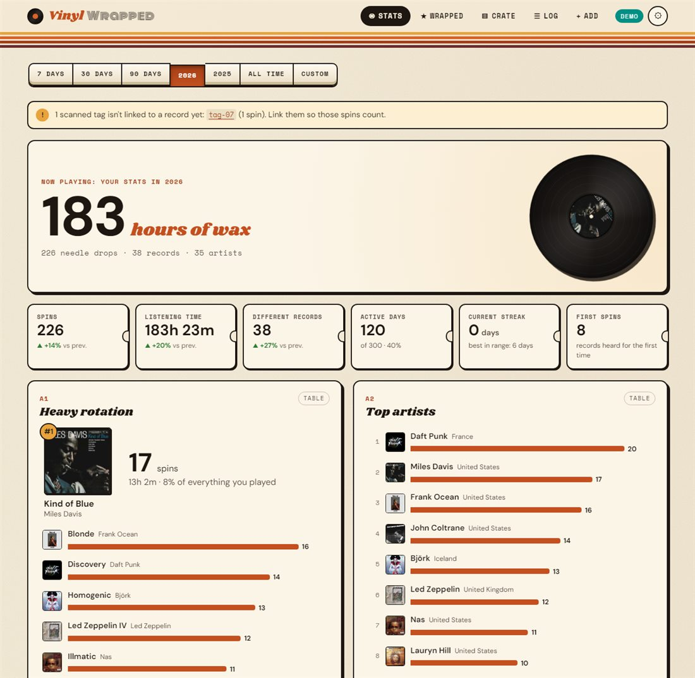
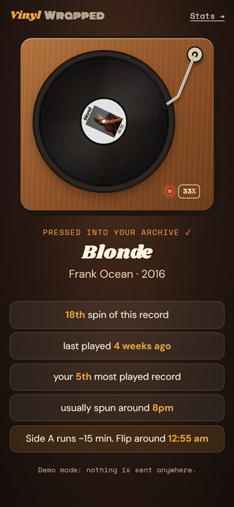
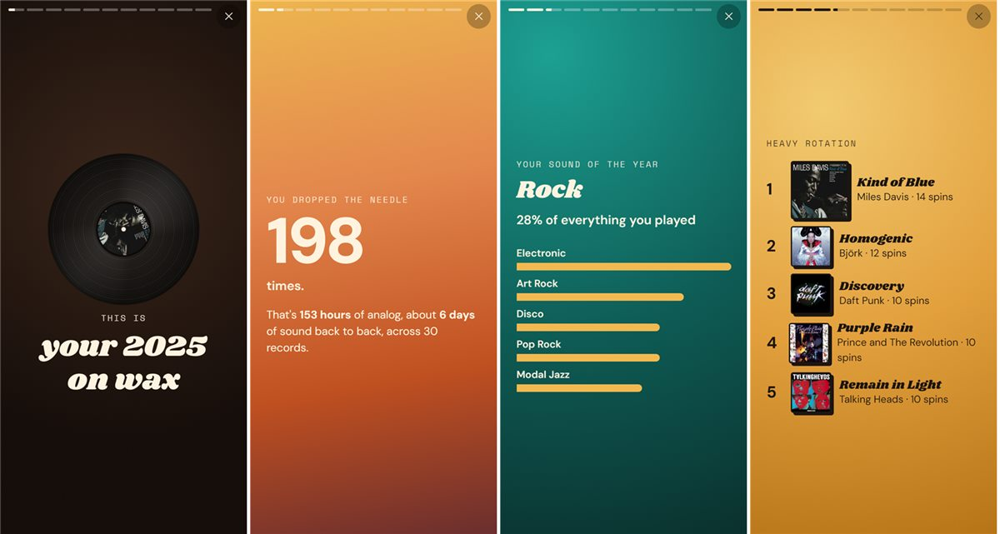
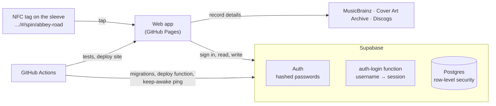

# VinylWrapped

**Spotify Wrapped for the records you actually spin.** Stick a cheap NFC tag on each record and tap it with your iPhone when the needle drops. VinylWrapped logs the spin. Over time you get your top records, artists, genres, labels and decades, a listening clock, streaks, records gathering dust, a "listening personality", and a story-style **Wrapped** for every year.

It's a shared site: anyone can **sign up with a username and password**, keep their own crate, and **browse other listeners' stats and Wrapped**. Each person decides who can see their crate.

| Stats | Tap a tag | Wrapped |
| --- | --- | --- |
|  |  |  |

## How it works



- **GitHub** holds the code. **Pages** hosts the website, and **Actions** runs everything operational: tests, deploying the site, applying database changes, deploying the sign-in function, and a ping that keeps the free database awake.
- **[Supabase](https://supabase.com)** (free tier) provides accounts and a Postgres database. GitHub can't do this part: Pages only serves files, and Actions can't answer a login request. Putting a GitHub token in a public site would let anyone take over the repository.
- **The browser** computes all the stats (`shared/stats.ts`). It also fetches record details (genres, tracklist, pressing, artist origins, cover art, Discogs styles) straight from MusicBrainz when you add a record.

## Security

Everything sensitive is enforced by the database itself, not by the website. A modified client can't get around it.

- **Passwords** are handled by Supabase Auth: stored hashed with bcrypt, never in our tables, never visible to anyone. Sign-in is throttled. After 10 wrong passwords a username is locked for 15 minutes.
- **Emails** stay in Supabase Auth's private table. Nobody else can read them, and they aren't exposed through the API. Username sign-in goes through a small server-side function (`supabase/functions/auth-login`). It looks up the email with a secret key that never reaches the browser, and gives the same answer for "no such user" and "wrong password".
- **Row-level security on every table:** you can only add, change or delete *your own* records and spins. You can't even name another user as the owner of a row.
- **Visibility:** each profile is **Public** (anyone with the link), **Members** (signed-in users, the default) or **Private** (only you). The same rules decide what the People page lists and counts.
- **Abuse limits:** usernames are validated and some names are reserved, records are size-checked, and each account is capped at 5,000 records and 100,000 spins. Cover images may only come from the Cover Art Archive or Discogs, so a profile can't load tracking images from arbitrary sites when someone views it.
- **Secrets:** the database password and access token live in encrypted GitHub Secrets. The site's Supabase URL and *publishable* key are public by design; on their own they grant nothing that the security rules don't allow.
- **Tested:** `supabase/tests/database.test.ts` runs the real migration in an in-process Postgres and attacks it from each role: signed out, members, other users, the server. The Database workflow runs those tests before every migration.

## Run your own instance (about 20 minutes)

You need a GitHub account and a free Supabase account.

**1. Create the Supabase project**

1. On [supabase.com](https://supabase.com), create a new project. Pick a region near your users and a strong **database password**, and save it.
2. *Authentication → URL Configuration*: set **Site URL** to your site, e.g. `https://<you>.github.io/VinylWrapped/`, and add the same URL under **Redirect URLs**.
3. *Authentication → Sign In / Providers → Email*: decide on **Confirm email**.
   - **On:** new users must click a link in an email before signing in.
   - **Off:** users can use their account immediately.
4. *Authentication → Emails → SMTP settings*: Supabase's built-in email sender only delivers to your own team's addresses and is heavily rate-limited. For password resets (and confirmations) to reach real users, connect an SMTP provider, e.g. [Resend](https://resend.com), whose free tier is enough.
5. Optional hardening: *Authentication → Attack Protection* lets you add a CAPTCHA to sign-ups, and you can raise the minimum password length (the app asks for at least 8 characters).

**2. Connect GitHub**

In your repository's *Settings → Secrets and variables → Actions*:

| Kind | Name | Where to find it |
| --- | --- | --- |
| Variable | `SUPABASE_URL` | Supabase: *Project Settings → Data API → Project URL* (`https://<ref>.supabase.co`) |
| Variable | `SUPABASE_PUBLISHABLE_KEY` | Supabase: *Project Settings → API Keys* (`sb_publishable_…`) |
| Variable | `SUPABASE_PROJECT_REF` | The `<ref>` part of the project URL |
| Secret | `SUPABASE_ACCESS_TOKEN` | Supabase: *Account → Access Tokens → Generate new token* |
| Secret | `SUPABASE_DB_PASSWORD` | The database password from step 1 |

**3. Deploy**

1. *Settings → Pages → Source*: **GitHub Actions**.
2. *Actions → Database → Run workflow*. This tests and applies the schema and security rules, and deploys the sign-in function.
3. *Actions → Deploy → Run workflow*. The site goes live at `https://<you>.github.io/VinylWrapped/`.
4. Open the site and **sign up**.

From then on, pushing to `main` redeploys automatically. Changes under `supabase/` also re-run the Database workflow, and the *Keep database awake* workflow pings Supabase every three days. Free projects pause after a week without activity.

## Using it

- **Sign up** with a username, an email (only for password resets, never shown) and a password.
- **Add records:** *Add* → search MusicBrainz → pick your pressing. The details fill in automatically.
- **Tag them:** each record has a sticker link (below).
- **Spin:** tap the sticker and the spin is logged to whoever is signed in on that phone.
- **People:** browse other listeners and open their stats, Wrapped and crate. Choose who can see yours in *Settings*.

### NFC tags

**What to buy:** NTAG215 (or NTAG213/216) stickers. Small round 25–30 mm ones fit on an inner sleeve or inside the jacket. Keep them off metal.

**Write a tag (once per record):** on the record's page, copy its sticker link. In the free **NFC Tools** iOS app, go to *Write → Add a record → URL/URI*, paste the link, tap *Write*, and hold the top of the iPhone to the sticker.

**Log a spin:** hold your unlocked iPhone (XS or newer) near the sticker and tap the *Open in Safari* banner. Sign in once on the phone; after that it's tap, tap, music.

> Tip: write a stack of stickers with ids like `tag-01`, `tag-02`… in one go. The first time you scan an unknown one, the spin is kept and VinylWrapped asks which record it belongs to.

## Development

Requires Node 24+.

```bash
npm install
npm run dev        # http://localhost:5173 (demo crate without a backend)
npm test           # stats engine, enrichment, sign-in function, and the database security tests
npm run build      # typecheck + production build into dist/
```

To develop against a real project, create `.env.local` in the repository root:

```
VITE_SUPABASE_URL=https://<ref>.supabase.co
VITE_SUPABASE_PUBLISHABLE_KEY=sb_publishable_…
```

```
web/        React app: pages/, components/ (charts, turntable, covers), lib/ (store, api, supabase, router)
shared/     data model, stats engine, personality, genres, MusicBrainz enrichment (used by the app and tests)
supabase/   migrations/ (schema + security rules), functions/auth-login/, tests/
.github/    deploy.yml (Pages), supabase.yml (database), keepalive.yml, ci.yml
```

**Design:** cream liner-note paper, ink outlines and 70s sunset stripes, with Shrikhand, Monoton, Space Mono and DM Sans (self-hosted, no font CDN). Chart colors come from a palette checked for color-vision-deficiency separation and contrast, and every chart has a table view.

## Troubleshooting

- **Deploy fails with "Set the repository variables…":** add `SUPABASE_URL` and `SUPABASE_PUBLISHABLE_KEY` (step 2).
- **Deploy fails with "Get Pages site failed":** set *Settings → Pages → Source* to GitHub Actions and run Deploy again.
- **Sign-up says "Database error saving new user":** the Database workflow hasn't run yet, or the username is taken.
- **Password-reset emails never arrive:** connect an SMTP provider (step 1.4).
- **The site says it can't reach the server after a quiet week:** the free Supabase project paused. Restore it from the Supabase dashboard; the keep-awake workflow prevents this while it's enabled.
- **Safari asks you to sign in again after a long break:** Safari can clear site storage after about a week of not visiting the site.
